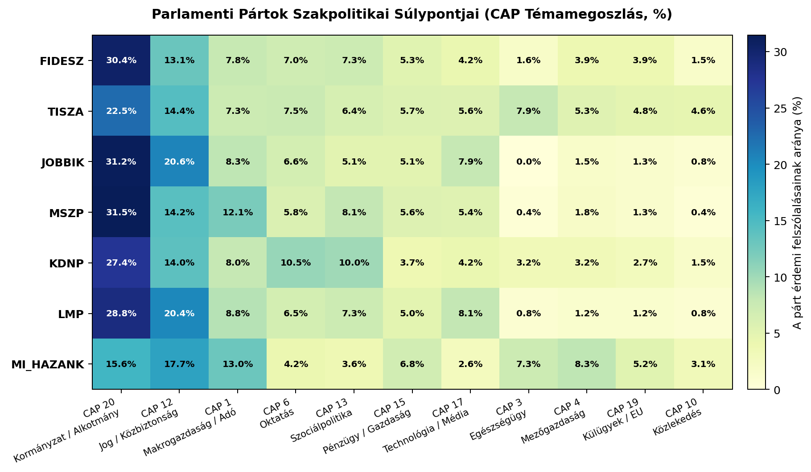
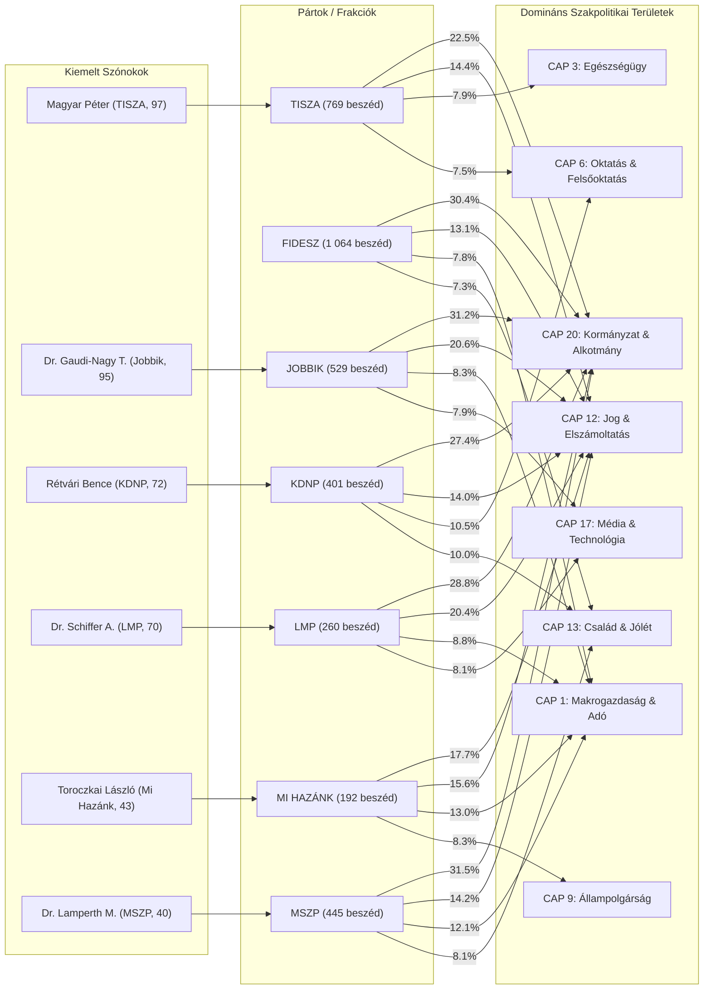

# 🏛️ Magyar Parlamenti Felszólalások, Kérdések és Törvényjavaslatok Adatbázisa
## 2010 és 2026 Kormányváltás Utáni 100 Nap Teljes Összehasonlító Adatbázisa

Ez a projekt a **2010-es** és a **2026-os** magyar kormányváltást (az Országgyűlés megalakulását) követő első **100 nap** összes plenáris felszólalását, kérdését (interpellációk, azonnali és írásbeli kérdések), valamint **törvényjavaslatát és jogalkotási döntését** gyűjti össze, rendszerezi és kategorizálja a hivatalos parlamenti jegyzőkönyvek és a PAIR WebAPI alapján.

---

## 📌 1. Időszakok és Kontextus

| Paraméter | 2010-es kormányváltás | 2026-os kormányváltás |
| :--- | :--- | :--- |
| **Ciklus száma** | 39. parlamenti ciklus | 43. parlamenti ciklus |
| **Alakuló ülés dátuma** | **2010. május 14.** | **2026. május 9.** |
| **100 napos időszak vége**| **2010. augusztus 22.** | **2026. augusztus 17.** |
| **Kormányzó erő** | Fidesz – KDNP (kétharmados többség) | TISZA Párt (kormánytöbbség) |
| **Ellenzéki frakciók** | MSZP, Jobbik, LMP, Függetlenek | Fidesz, KDNP, Mi Hazánk |
| **Főbb törvényhozási fókusz** | Kettős állampolgárság, Trianon-emléknap, Alkotmánymódosítások, 29 pontos gazdasági akcióterv, bankadó, Nemzeti Együttműködés Nyilatkozata | Jogállamisági reformok, uniós források feloldása, Szuverenitásvédelmi Hivatal megszüntetése, egészségügyi & oktatási reformok, vagyonvisszaszerzés |

---

## 📊 2. Főbb Statisztikai Mutatók (Tisztított, ≥ 200 szavas Felszólalásokkal)

> [!NOTE]
> Az adatbázisból eltávolításra kerültek a 200 szónál rövidebb, tisztán procedurális bekiabálások, levezető elnöki átadások és rövid ügyrendi megjegyzések. A szakpolitikai elemzésekből továbbá kiszűrésre kerültek az elnöki technikai szavaztatások és határozathirdetések (`is_procedural = 1`, 60 db), így a tiszta érdemi korpusz 3 813 felszólalást tartalmaz.

| Kategória | 2010 (Orbán-kormány) | 2026 (Új kormányzat) | Összesen |
| :--- | :---: | :---: | :---: |
| **Ülésnapok száma** | 28 nap | 23 nap | **51 ülésnap** |
| **Érdemi felszólalások (≥ 200 szó, procedurális nélkül)** | **2 279 db** | **1 534 db** | **3 813 felszólalás** (összesen 3 873 db) |
| **Kérdések és interpellációk** | 659 db | 1 366 db | **2 025 kérdés** |
| **Benyújtott törvényjavaslatok** | **66 db** | **61 db** | **127 törvényjavaslat** |
| **Elfogadott törvények (kihirdetve)** | **56 db (84.8%)** | **15 db (24.6%)** | **71 elfogadott törvény** |
| **Elutasított javaslatok** | 2 db (LMP javaslatok) | 0 db | **2 elutasított** |
| **Folyamatban maradt / bizottsági** | 8 db | 46 db | **54 folyamatban** |
| **Rögzített szótagszám (felszólalások)** | **1 335 399 szó** | **941 591 szó** | **2 276 990 szó** |

---

## ⚖️ 3. Törvényjavaslatok Eredményessége Frakciónként

### 2010 (Orbán-kormány első 100 napja):
- **Fidesz**: 28 javaslat benyújtva -> **27 elfogadva (96%)**
- **Fidesz-KDNP közös**: 15 javaslat benyújtva -> **15 elfogadva (100%)**
- **Kormány**: 12 javaslat benyújtva -> **11 elfogadva (92%)**
- **KDNP önálló**: 3 javaslat benyújtva -> **3 elfogadva (100%)**
- **LMP (ellenzék)**: 2 javaslat benyújtva -> **0 elfogadva (100% elutasítva a napirendről)**
- **MSZP (ellenzék)**: 1 javaslat benyújtva -> **0 elfogadva**
- **Függetlenek**: 5 javaslat -> **0 elfogadva**

### 2026 (Új kormányzat első 100 napja):
- **Kormány**: 31 javaslat benyújtva -> **7 elfogadva (23%)**, 24 folyamatban/tárgyalás alatt
- **TISZA**: 13 javaslat benyújtva -> **8 elfogadva (62%)**, 5 folyamatban
- **Mi Hazánk (ellenzék)**: 13 javaslat benyújtva -> **0 elfogadva**, folyamatban
- **KDNP (ellenzék)**: 2 javaslat benyújtva -> **0 elfogadva**, folyamatban
- **Fidesz / Fidesz-KDNP (ellenzék)**: 2 javaslat benyújtva -> **0 elfogadva**, folyamatban

---

## 🗄️ 4. Adatbázis Architektúra (`parlament_100nap.db`)

Az adatbázis motorja a beépített **SQLite 3**, amely teljes relációs integritást, idegen kulcsokat és beépített **FTS5 Full-Text Search** keresőmotort biztosít.

### Szakpolitikai Taxonómia: CAP Master Codebook
Az adatbázis besorolása a hivatalos nemzetközi **Comparative Agendas Project (CAP) Master Codebook** (`https://www.comparativeagendas.net/pages/master-codebook`) rendszert követi, amely 21 főtémát és 209 altémát tartalmaz:
- **Topic 1:** Makrogazdaság (Macroeconomics)
- **Topic 2:** Polgári jogok, szabadságjogok és kisebbségek (Civil Rights, Minority Issues, and Civil Liberties)
- **Topic 3:** Egészségügy (Health)
- **Topic 4:** Mezőgazdaság (Agriculture)
- **Topic 5:** Munkaügy és foglalkoztatás (Labor)
- **Topic 6:** Oktatás (Education)
- **Topic 7:** Környezetvédelem (Environment)
- **Topic 8:** Energiaügy (Energy)
- **Topic 9:** Bevándorlás és állampolgárság (Immigration and Citizenship)
- **Topic 10:** Közlekedés (Transportation)
- **Topic 12:** Jog, igazságszolgáltatás és közbiztonság (Law, Crime, and Family Issues)
- **Topic 13:** Szociálpolitika és jólét (Social Welfare)
- **Topic 14:** Lakásügy és településfejlesztés (Community Development and Housing Issues)
- **Topic 15:** Belkereskedelem és pénzügyi szektor (Banking, Finance, and Domestic Commerce)
- **Topic 16:** Honvédelem és katonapolitika (Defense)
- **Topic 17:** Technológia, média és távközlés (Space, Science, Technology and Communications)
- **Topic 18:** Külkereskedelem (Foreign Trade)
- **Topic 19:** Nemzetközi kapcsolatok és külügyek (International Affairs and Foreign Aid)
- **Topic 20:** Kormányzati működés, alkotmányosság és választások (Government Operations)
- **Topic 21:** Állami földek és vízgazdálkodás (Public Lands and Water Management)
- **Topic 23:** Kultúra (Culture)

### Fő táblák:
1. `bill`: Törvényjavaslatok táblája (irományszám, cím, rövid cím, érintett törvény, benyújtók, frakció, státusz, szavazatok, döntési dátum, CAP főtéma kód és altéma kód).
2. `speech`: A felszólalások teljes szövege, időpontja, szószáma és forráslinkje, kapcsolata a `bill_id`-vel.
3. `question`: Kérdések, interpellációk és azonnali kérdések (szöveg, miniszteri válasz, elfogadás státusza).
4. `speech_classification` & `question_classification`: Tematikus besorolás a CAP Master kódok szerint (főtéma és altéma).
5. `speech_retrospective_critique`: Múltbírálati szűrő ("elmúlt 8 év" és "elmúlt 16 év" reflexiók, idézetekkel és intenzitással).
6. `parliamentary_group`: Képviselőcsoportok / frakciók adatai és kormányzati státusza.
7. `topic_category`: A CAP Master Codebook 21 főtémája és 209 altémája hierarchikus rendben (kód, név, angol név, szülő kód).
8. `speech_fts`: FTS5 virtuális keresőtábla a beszédek szövegében való másodpercen belüli kereséshez.

### Kényelmi Nézetek (Views):
- `v_bills_categorized`: Összesített törvényjavaslati nézet CAP kódokkal (`cap_major_code`, `cap_subtopic_code`, `primary_topic`, `primary_topic_en`).
- `v_speeches_categorized`: Összesített beszédek frakció, CAP kódok és múltbírálat szerint.
- `v_questions_categorized`: Kérdések és interpellációk nézete CAP kódokkal.

---

## 📊 5. Felszólalók és Pártok Tematikus Besorolása (Ki hova került?)

Az alábbi diagram és hőtérkép bemutatja, hogy a két kormányváltás utáni első 100 napban az egyes politikai erők és kulcsszereplők felszólalásai milyen szakpolitikai témakategóriákba (CAP kódok) kerültek.

### 5.1. Pártok Szakpolitikai Súlypontjai (Hőtérkép)



### 5.2. Frakciók és Kulcspolitikusok Tematikus Térképe (Mermaid folyamatábra)



### 5.3. A Legaktívabb Felszólalók Tematikus Profilja

| Képviselő / Szónok | Frakció | Össz. beszéd | 1. Fő téma | 2. Fő téma | 3. Fő téma |
|:---|:---:|:---:|:---|:---|:---|
| **Magyar Péter** | TISZA | 97 db | **CAP 13 Szociálpolitika** (18 db) | **CAP 20 Kormányzat** (18 db) | **CAP 3 Egészségügy** (12 db) |
| **Dr. Gaudi-Nagy Tamás** | Jobbik | 95 db | **CAP 12 Jog / Elszámoltatás** (39 db) | **CAP 20 Alkotmányosság** (34 db) | **CAP 9 Állampolgárság** (5 db) |
| **Rétvári Bence** | KDNP | 72 db | **CAP 20 Kormányzati működés** (30 db) | **CAP 12 Jog és bíróságok** (12 db) | **CAP 6 Oktatás** (8 db) |
| **Dr. Schiffer András** | LMP | 70 db | **CAP 12 Jogállamiság / Btk.** (26 db) | **CAP 20 Házszabály** (26 db) | **CAP 1 Makrogazdaság** (7 db) |
| **Novák Előd** | Jobbik / Mi Hazánk | 59 db | **CAP 20 Kormányzat** (24 db) | **CAP 12 Rendvédelem** (22 db) | **CAP 17 Médiatörvény** (17 db) |
| **Volner János** | Jobbik | 47 db | **CAP 20 Kormányzati struktúra** (24 db) | **CAP 1 Adó és költségvetés** (6 db) | **CAP 12 Jog** (5 db) |
| **Toroczkai László** | Mi Hazánk | 43 db | **CAP 12 Közbiztonság / Bűnözés** (11 db) | **CAP 20 Kormányzat** (11 db) | **CAP 9 Migráció / Határ** (7 db) |
| **Dr. Lamperth Mónika** | MSZP | 40 db | **CAP 20 Önkormányzatok** (27 db) | **CAP 12 Jog** (10 db) | **CAP 6 Közoktatás** (3 db) |
| **Nacsa Lőrinc** | KDNP | 40 db | **CAP 20 Kormányzat** (13 db) | **CAP 12 Közbiztonság** (7 db) | **CAP 15 Fogyasztóvédelem** (4 db) |

---

## 📁 6. Elérhető Exportok és Fájlok

- `cap_master_codebook.json`: A CAP Master Codebook teljes struktúrája gépileg feldolgozható JSON formátumban (21 téma, 209 altéma leírásokkal).
- `exports/torvenyjavaslatok_kategorizalva.csv`: 127 db törvényjavaslat CAP kódokkal, benyújtóval, érintett törvénnyel és eredménnyel.
- `exports/felszolalasok_kategorizalva.csv`: 3 873 db érdemi felszólalás (≥ 200 szó, megtisztítva a taps és közbekiabálás elemektől) CAP kódokkal és metaadatokkal.
- `exports/kerdesek_kategorizalva.csv`: 2 025 db kérdés és interpelláció CAP kódokkal.
- `parlament_100nap_riport.html` / `riport.html`: Egyetlen önálló fájlból álló, interaktív vizuális dashboard (diagramok, KPI kártyák, kereshető törvényjavaslati táblázat).
- `parlamenti_adatbazis_100nap.zip`: A teljes projekt becsomagolva, megosztható formátumban.

---

## 🚀 6. Használat

### Interaktív riport megtekintése:
Egyszerűen nyisd meg duplán kattintva a böngésződben:
`parlament_100nap_riport.html` vagy `riport.html`

Vagy indíts helyi webszervert a terminálból:
```bash
python3 serve.py
```
Majd nyisd meg: `http://localhost:8000`

### Törvényjavaslatok újrafeldolgozása és exportja:
```bash
python3 pipeline/process_bills.py
```
